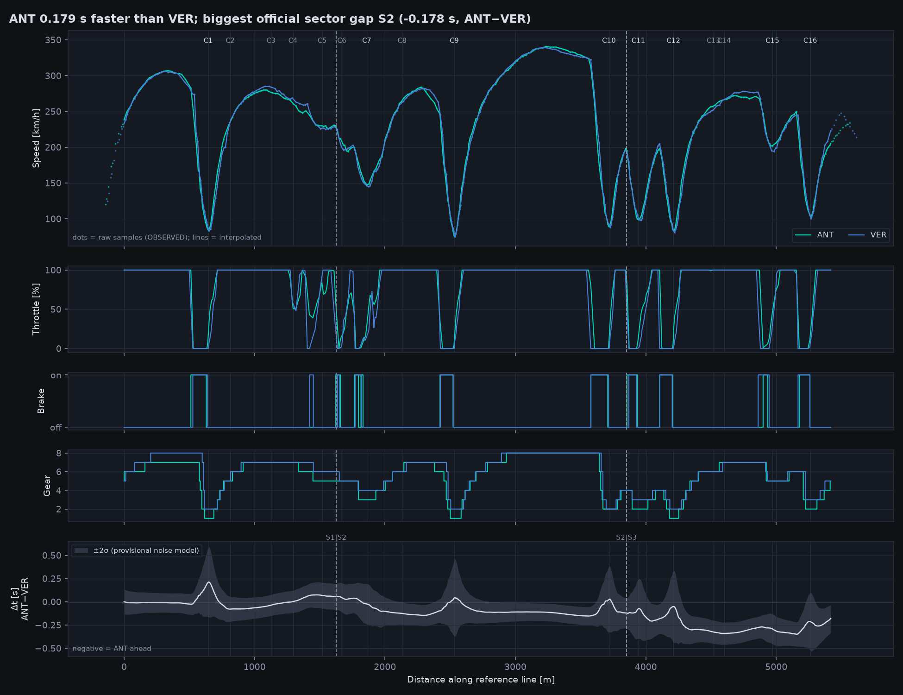
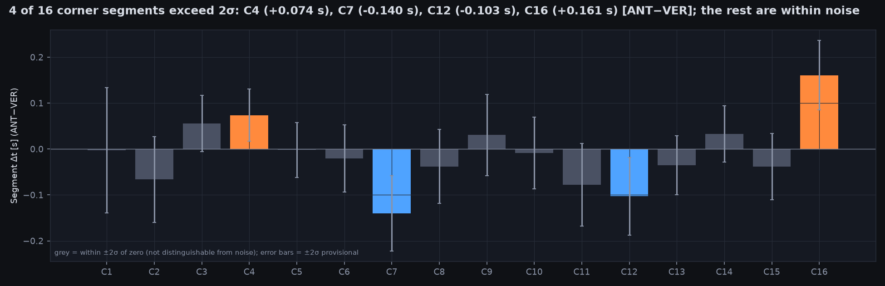

# Case study 01: where was pole won?

**2026 United States GP qualifying, Q3: Antonelli (ANT, lap 14, 94.035 s, pole) vs
Verstappen (VER, lap 8, 94.214 s, P2).**

Reproduce offline: `uv run python examples/case_study_01.py`. Outputs are in
[`docs/case_study_01/`](case_study_01/); the full tagged list is
[`claims.md`](case_study_01/claims.md).

> **Correction (Phase 3).** The Phase 2 version of this page called the C16 difference
> (ANT 0.161 s slower) OBSERVED. Sensitivity analysis shows that is not stable: across
> 27 lap pairings and 9 analysis configurations, VER is usually faster through C16, but
> only 52% of configurations agree. It is INCONCLUSIVE, and the Phase 2 claim is withdrawn.
> C7, described in Phase 2 as an unresolved gain, is also INCONCLUSIVE (stability 64%).

Claims use four tags, as in [METHODOLOGY](METHODOLOGY.md):
**OBSERVED** (data shows it, stable across configurations),
**HYPOTHESIS** (consistent with the data; confounders listed),
**INCONCLUSIVE** (within noise, or not stable), and
**UNKNOWN** (public data cannot establish it).

## 1. Validation first

| Lap | lap-time z | sector error before anchoring [ms] | tolerance [ms] | gate |
|---|---|---|---|---|
| ANT 14 | −0.07 | −10 / +71 / −61 | 148 / 229 / 174 | **PASS** |
| VER 8 | −0.15 | +51 / +14 / −65 | 150 / 232 / 177 | **PASS** |

Both laps are consistent with their official times. After sector anchoring, the analysis
reproduces the official lap gap (−0.179 s) and all three sector gaps exactly.

## 2. Sensitivity: how much of this survives?

Each segment verdict was recomputed for every pairing of the top three laps of each driver
(9 pairings), with three reference-line sets and three alignment methods (81
configurations per segment). Stability is the share of configurations agreeing with the
majority verdict. A conclusion is OBSERVED only at 80% or higher.

| Segment | Majority verdict | Stability | Mean Δ [s] (ANT − VER) | Tag |
|---|---|---|---|---|
| C7 (1766–1996 m) | ANT faster | 64% | −0.125 | INCONCLUSIVE |
| C16 (5116–5418 m) | VER faster | 52% | +0.068 | INCONCLUSIVE (Phase 2 claim withdrawn) |
| All other segments (incl. C12) | no reliable difference | 48–93% | | INCONCLUSIVE |

No corner segment is stable. The official S2 gap (ANT 0.178 s faster) is real, but
Apex cannot say which corners produced it.

## 3. What the data says

| # | Tag | Statement |
|---|---|---|
| 1 | OBSERVED | ANT's lap was **0.179 s** faster (official). |
| 2 | OBSERVED | By sector (official, ANT − VER): **S1 +0.056 s**, **S2 −0.178 s**, **S3 −0.057 s**. ANT lost time in S1 and won it back in S2. |
| 3 | OBSERVED (method) | Telemetry alone, before sector anchoring, puts the S1 gap at **−0.004 s**: the wrong sign. Single-lap timing noise (about 70 ms per sector) is larger than that sector's real gap, which is why Apex anchors to official sector times. |
| 4 | OBSERVED, stability 81% | ANT reaches 20% throttle **21 m earlier** after the minimum at C11. |
| 5 | OBSERVED, stability 89% | VER brakes **30 m earlier** into C15 (resolution ±15 m). |
| 6 | OBSERVED, stability 100% | VER has **8 km/h lower** minimum speed through C15 (raw samples). |
| 7 | INCONCLUSIVE, stability 41% | "VER brakes 43 m earlier into C7": the difference in this one lap pair is real, but it flips across pairings. The median across pairings is about 8 m, with VER braking earlier. |
| 8 | HYPOTHESIS | The C15 brake-point and minimum-speed differences are consistent with a deliberate earlier brake point, with the entry line, tyre state and traffic as alternative explanations (listed in `claims.md`). |
| 9 | HYPOTHESIS | The C11 earlier throttle pickup is consistent with earlier traction. Throttle is pedal position, and pedal-to-torque maps differ between power units, so equal pedal % is not equal torque. |
| 10 | HYPOTHESIS | Track evolution may favour VER, who set his lap 8 s after ANT's. |
| 11 | OBSERVED | Speed traps: ANT 328 km/h, VER 326 km/h. The 2 km/h difference is below the 3 km/h threshold, so no claim is made. |
| 12 | OBSERVED | Both laps were on new SOFT tyres, and both were the first push lap of their stints. |
| 13 | UNKNOWN | Tyre temperatures, fuel load, ERS state, active-aero mode, setup, driver intent and slipstream are not in the public data. Any of them could drive claims 4–9. |

## 4. What this case study shows

- **Official timing is the strongest signal.** It shows where pole was decided at sector
  level (S2). Telemetry alone gets the S1 sign wrong.
- **Corner-level attribution is mostly below what this feed can resolve.** No segment is
  stable enough to claim, once the choices behind the analysis are varied.
- **Some event-level differences survive.** Brake points and throttle pickups, measured
  against their sample-spacing resolution, are more robust than segment times. The C15
  brake point and minimum speed are the strongest observations here.

## Outputs

[`claims.md`](case_study_01/claims.md) (tagged claims) ·
[`sensitivity_segments.csv`](case_study_01/sensitivity_segments.csv) ·
[`sensitivity_events.csv`](case_study_01/sensitivity_events.csv) ·
[`sensitivity_raw_segments.csv`](case_study_01/sensitivity_raw_segments.csv) ·
[`summary.md`](case_study_01/summary.md) · [`sectors.csv`](case_study_01/sectors.csv) ·
[`corner_segments.csv`](case_study_01/corner_segments.csv) ·
[`corners.csv`](case_study_01/corners.csv) · [`gate.json`](case_study_01/gate.json)

Corner labels `C1…C16` are Apex's numbering, not official turn numbers
([METHODOLOGY §6](METHODOLOGY.md#6-track-model-and-corners)).
